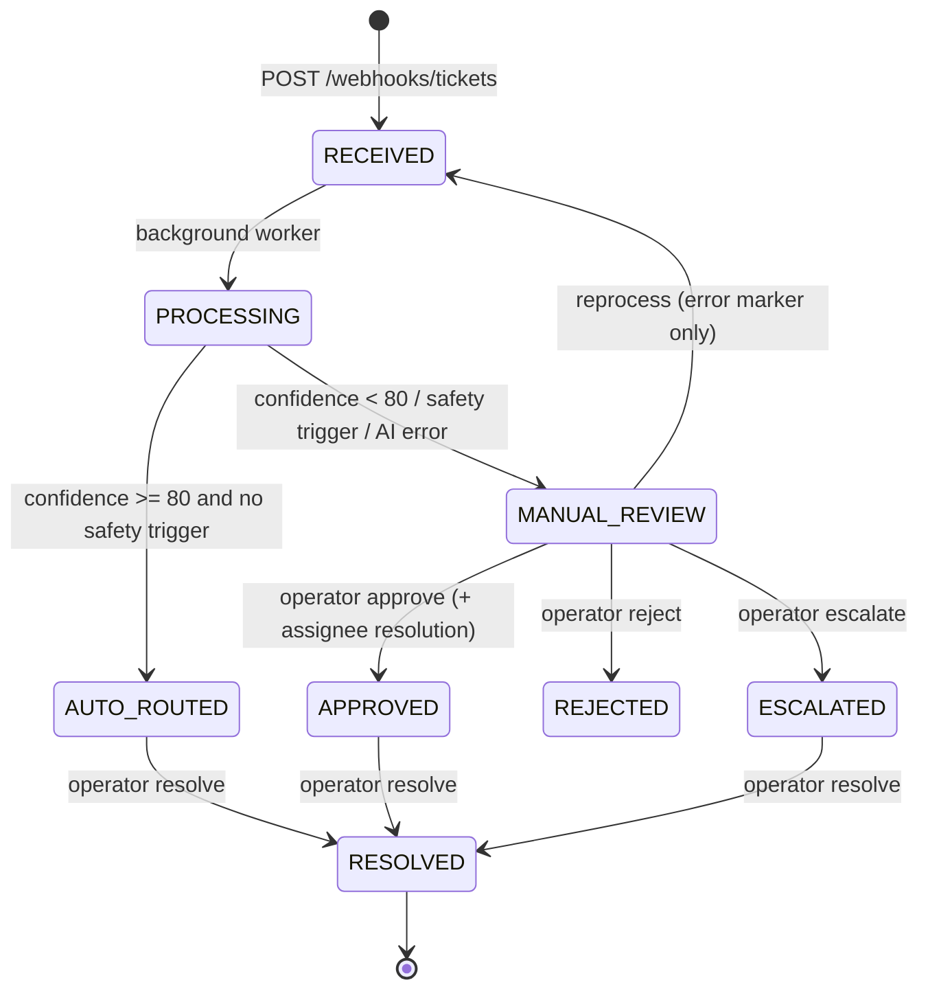

# TicketPilot AI

**AI-powered support ticket automation with safety-first routing.**

FastAPI backend that ingests support tickets via webhook, classifies them with an LLM
(category, urgency, summary, confidence), auto-routes confident results, and forces
human review for anything ambiguous, sensitive, or low-confidence.

Built as an engineering portfolio piece against a real Upwork-style specification:
classification, AI-result validation, routing, duplicate handling, logging, tests,
Swagger — and a hard rule that the system never auto-accepts a doubtful decision.

---

## Highlights

- **Real AI integration, not a mock.** Verified end-to-end against
  Qwen2.5-7B-Instruct (GGUF Q4_K_M) served locally by llama.cpp, and against
  OpenAI-compatible cloud endpoints via env swap.
- **Safety gates.** Deterministic rules override AI confidence: ambiguous bodies,
  sensitive keywords (GDPR / legal / security / production outage), and
  confidence < 80 always route to `MANUAL_REVIEW`.
- **Graceful degradation.** LLM timeout, network error, HTTP 5xx/429 after retries,
  or unparseable JSON → ticket lands in `MANUAL_REVIEW` with an `AI_UNAVAILABLE` /
  `SYSTEM_ERROR` marker. Tickets are never lost and never auto-routed on garbage.
- **Idempotent ingestion.** Duplicate `external_id` returns the existing ticket (202)
  without re-scheduling processing — webhook retries are safe.
- **Strict state machine** with full audit history on every transition.
- **Reprocess path.** Tickets whose AI step failed can be retried via
  `POST /admin/tickets/{id}/reprocess` (only when an error marker is present).
- **Layered architecture.** Routers → Services → Repositories → Clients, with an
  explicit DI container. No global singletons; the app either builds fully or fails fast.
- **Test suite: 183 tests, 93% coverage.** Unit, repository, contract (httpx
  MockTransport), integration (real SQLite), E2E flows, security matrix,
  state-machine matrix, and a 30-ticket live batch validator.

---

## Architecture

```
HTTP request
     │
     ▼
┌────────────────────────────────────────────────────────────┐
│ Routers (FastAPI)                                          │
│   auth (API keys), Pydantic validation, OpenAPI contract   │
└────────────────────────────────────────────────────────────┘
     │ Depends(...)
     ▼
┌────────────────────────────────────────────────────────────┐
│ Services (business logic)                                  │
│   TicketService        state machine, history, idempotency │
│   TicketProcessing     AI orchestration + safety gates     │
│   RoutingService       rules → assignee resolution         │
│   MetricsService       summary / accuracy / timings        │
└────────────────────────────────────────────────────────────┘
     │
     ▼
┌──────────────────────────┐   ┌─────────────────────────────┐
│ Repositories (SQLAlchemy)│   │ Clients                     │
│   tickets / history      │   │   OpenAILLMClient           │
│   routing rules          │   │   (OpenAI / llama.cpp /     │
│   metrics aggregates     │   │    Ollama / vLLM — any      │
└──────────────────────────┘   │    OpenAI-compatible API)   │
     │                         └─────────────────────────────┘
     ▼
 SQLite (local) / PostgreSQL (prod-ready via SQLAlchemy)
```

Background classification runs in FastAPI `BackgroundTasks` on its **own** DB session
(independent from the request session). On unexpected crash of the background step,
a recovery path moves `PROCESSING → MANUAL_REVIEW` with a `SYSTEM_ERROR` marker so a
ticket can never be stuck forever.

### Ticket state machine



Every transition writes a `ticket_history` row (action, old/new value, actor, timestamp).

### Deterministic safety gates

Forced to `MANUAL_REVIEW` regardless of AI confidence:

- body shorter than 20 characters;
- ambiguous patterns: `help`, `urgent`, `see attached`, `it doesn't work`,
  `something is wrong`, `urgent help`;
- sensitive keywords: `gdpr`, `legal`, `lawsuit`, `security`, `compromised`,
  `production outage`, `charge twice`, `duplicate charge`;
- AI confidence below `AI_CONFIDENCE_THRESHOLD` (default 80).

---

## Tech stack

| Layer      | Choice                                              |
|------------|-----------------------------------------------------|
| Framework  | FastAPI (async), Pydantic v2, pydantic-settings     |
| ORM / DB   | SQLAlchemy 2.0 async, Alembic; SQLite local / PostgreSQL ready |
| HTTP       | httpx (async client), tenacity (bounded retries)    |
| AI         | Any OpenAI-compatible endpoint: OpenAI, llama.cpp, Ollama, vLLM |
| Tests      | pytest, pytest-asyncio, pytest-cov, httpx MockTransport |
| Lint       | Ruff                                                |
| Tooling    | uv (deps + lockfile)                                |

Local inference model: **Qwen2.5-7B-Instruct** (7.61B params, 28 layers, GQA 28/4,
native 128K context, strong structured-JSON behavior — see Qwen2.5 model card),
quantized to GGUF Q4_K_M.

---

## Project structure

```
ticketspilot-ai/
├── main.py                     # uvicorn entrypoint (outside the package)
├── pyproject.toml              # deps, pytest/ruff config
├── uv.lock
├── alembic.ini
├── alembic/
│   ├── env.py                  # async migration env, sys.path bootstrap
│   └── versions/
│       └── 4953eb724f44_initial_schema.py
├── app/
│   ├── app.py                  # TicketsPilotApplication (fail-fast assembly)
│   ├── config.py               # Settings + build_settings() (no global singleton)
│   ├── container.py            # ServiceContainer (app-scoped) + background entrypoint
│   ├── dependencies.py         # FastAPI dependency providers
│   ├── clients/
│   │   └── llm_client.py       # OpenAI-compatible client, robust JSON extraction
│   ├── core/
│   │   ├── exceptions.py       # typed HTTP exceptions
│   │   └── security.py         # constant-time API key checks
│   ├── database/
│   │   ├── base.py             # declarative base
│   │   ├── models.py           # Ticket, TicketHistory, RoutingRule + indexes
│   │   └── session.py          # Database wrapper, session scopes
│   ├── repositories/           # ticket / routing / metrics data access
│   ├── routers/                # webhooks, tickets, admin, metrics, health
│   ├── schemas/                # ticket / ai / admin Pydantic contracts
│   └── services/               # business logic + safety gates
├── data/
│   └── classification_suite.json   # 30 synthetic tickets (no PII)
├── scripts/
│   ├── seed_data.py            # idempotent demo seed
│   └── batch_classification_check.py  # live 30-ticket acceptance runner
├── reports/                    # batch reports (JSON/CSV), gitignored
└── tests/                      # 183 tests
```

---

## Quick start

### Prerequisites

- Windows/Linux/macOS, Python 3.11+ (project developed on 3.13)
- [uv](https://docs.astral.sh/uv/)
- One of:
  - **Local AI:** llama.cpp release build + Qwen2.5-7B-Instruct GGUF (works offline), or
  - **Cloud AI:** OpenAI API key

### 1. Dependencies

```powershell
uv sync --extra dev
```

### 2. Environment

```powershell
Copy-Item .env.example .env -Force
notepad .env
```

Local AI (llama.cpp) values:

```env
DATABASE_URL=sqlite+aiosqlite:///./ticketpilot.db
LLM_API_URL=http://127.0.0.1:8080/v1/chat/completions
LLM_MODEL=qwen2.5-7b
LLM_API_KEY=
LLM_TIMEOUT=120
LLM_MAX_RETRIES=1
LLM_ENABLE_JSON_MODE=false
LLM_MAX_TOKENS=300
AI_CONFIDENCE_THRESHOLD=80
ADMIN_API_KEY=dev-admin-key-change-in-production
WEBHOOK_API_KEY=dev-webhook-key-change-in-production
```

Cloud AI values:

```env
LLM_API_URL=https://api.openai.com/v1/chat/completions
LLM_MODEL=gpt-4o-mini
LLM_API_KEY=sk-...
LLM_TIMEOUT=20
LLM_MAX_RETRIES=2
LLM_ENABLE_JSON_MODE=true
```

### 3. LLM server (local path only, separate terminal)

```powershell
llama-server.exe `
  --model .\models\qwen2.5-7b\Qwen2.5-7B-Instruct-Q4_K_M.gguf `
  --alias qwen2.5-7b `
  --host 127.0.0.1 --port 8080 `
  --ctx-size 4096 `
  --n-gpu-layers 99 `
  --parallel 1 `
  --cache-ram 2048
```

Notes:

- Port is pinned explicitly: llama.cpp announces a future default change
  8080 → 9931 ([ggml-org/llama.cpp#26508](https://github.com/ggml-org/llama.cpp/pull/26508)).
  Never rely on the default.
- `--cache-ram` bounds host-memory prompt caching
  ([ggml-org/llama.cpp#16391](https://github.com/ggml-org/llama.cpp/pull/16391));
  default is 8192 MiB. 2048 MiB is plenty here and keeps 16 GB RAM hosts comfortable.
  This cache is why repeated classification calls reuse the shared system-prompt
  prefix (observed `cache_n=37` of 38 prompt tokens).
- By default llama-server reflects all CORS origins and warns
  ([ggml-org/llama.cpp#25655](https://github.com/ggml-org/llama.cpp/pull/25655)).
  It is bound to 127.0.0.1 here; for anything beyond a local demo add
  `--cors-origins localhost` (or your origin) and `--api-key`.
- If the log shows only CPU in `device_info` and no `ggml_cuda_init` lines, the CUDA
  backend did not register and inference runs on CPU (see Known limitations).

Preflight (must pass before any AI test):

```powershell
Invoke-RestMethod -Uri http://127.0.0.1:8080/v1/models -Method Get

$body = @{
    model = "qwen2.5-7b"
    messages = @(@{ role = "user"; content = 'Return JSON only: {"ok":true}' })
    temperature = 0
    max_tokens = 20
    stream = $false
} | ConvertTo-Json -Depth 5

Invoke-RestMethod -Uri http://127.0.0.1:8080/v1/chat/completions `
  -Method Post -Body $body -ContentType "application/json"
```

### 4. Database

```powershell
uv run python -m alembic upgrade head
uv run python .\scripts\seed_data.py
```

Seed is idempotent: first run inserts 3 routing rules + 6 demo tickets,
repeat runs insert nothing.

### 5. Backend

```powershell
uv run uvicorn main:app --reload
```

Swagger: `http://127.0.0.1:8000/docs` · ReDoc: `http://127.0.0.1:8000/redoc`

### 6. Smoke test

```powershell
$webHeaders = @{ "X-Webhook-API-Key" = "dev-webhook-key-change-in-production" }
$adminHeaders = @{ "X-Admin-API-Key" = "dev-admin-key-change-in-production" }

$payload = @{
    external_id = "demo-001"
    customer_email = "customer@example.com"
    subject = "Duplicate invoice charge"
    body = "I was charged twice for my monthly subscription. Please refund the duplicate payment."
} | ConvertTo-Json -Depth 5

$created = Invoke-RestMethod -Uri http://127.0.0.1:8000/webhooks/tickets `
  -Method Post -Headers $webHeaders -ContentType "application/json" -Body $payload

Start-Sleep -Seconds 20

Invoke-RestMethod -Uri http://127.0.0.1:8000/tickets/$($created.id) -Headers $adminHeaders
```

Expected: `status = AUTO_ROUTED`, `ai_category = Billing`, `assigned_to` resolved
from routing rules. An ambiguous body (e.g. `"help"`) yields `MANUAL_REVIEW` instead.

---

## API surface

| Method | Path                         | Auth        | Purpose                             |
| :----- | :--------------------------- | :---------- | :---------------------------------- |
| `GET`  | `/health`                    | —           | liveness                            |
| `POST` | `/webhooks/tickets`          | webhook key | idempotent ticket ingestion (202)   |
| `GET`  | `/tickets`                   | admin key   | paginated list, status filter       |
| `GET`  | `/tickets/{id}`              | admin key   | ticket detail                       |
| `GET`  | `/tickets/{id}/history`      | admin key   | audit trail                         |
| `GET`  | `/admin/reviews`             | admin key   | manual review queue                 |
| `POST` | `/admin/reviews/{id}/approve`| admin key   | approve + assignee resolution       |
| `POST` | `/admin/reviews/{id}/reject` | admin key   | reject AI decision                  |
| `POST` | `/admin/reviews/{id}/escalate`| admin key  | escalate to L2                      |
| `POST` | `/admin/tickets/{id}/resolve`| admin key   | close ticket                        |
| `POST` | `/admin/tickets/{id}/reprocess`| admin key | retry failed AI classification (202)|
| `GET`  | `/metrics/summary`           | admin key   | counts + auto-resolution rate       |
| `GET`  | `/metrics/accuracy`          | admin key   | approve/reject accuracy             |
| `GET`  | `/metrics/processing-time`   | admin key   | min/avg/max resolve time            |


Auth headers: `X-Webhook-API-Key`, `X-Admin-API-Key` (compared with
`secrets.compare_digest`, constant-time).

---

## Testing

Unit + integration (no network):

```powershell
uv run pytest -m "not integration" -q
uv run pytest -m "not integration" --cov=app --cov-report=term-missing --cov-fail-under=90
uv run ruff check .
```

Real LLM smoke (requires a live endpoint; local URLs count as valid targets):

```powershell
$env:RUN_REAL_LLM_TESTS = "1"
$env:LLM_API_URL = "http://127.0.0.1:8080/v1/chat/completions"
$env:LLM_MODEL = "qwen2.5-7b"
$env:LLM_API_KEY = ""
$env:LLM_TIMEOUT = "120"
$env:LLM_MAX_RETRIES = "1"
$env:LLM_ENABLE_JSON_MODE = "false"
$env:LLM_MAX_TOKENS = "300"

uv run pytest -m integration -v -s
```

Live 30-ticket acceptance run (backend must be up):

```powershell
$env:TICKETPILOT_BASE_URL = "http://127.0.0.1:8000"
$env:BATCH_POLL_TIMEOUT = "180"
$env:BATCH_POLL_INTERVAL = "2"
$env:BATCH_MIN_CATEGORY_ACCURACY = "0.80"
$env:BATCH_MIN_URGENCY_ACCURACY = "0.80"
$env:BATCH_FAIL_ON_SAFETY_VIOLATION = "true"

uv run python .\scripts\batch_classification_check.py
```

Reports land in `reports/` (`*_latest.json` / `*_latest.csv` plus per-run files).
The runner fails (exit 1) on any error case, any safety violation, or accuracy
below threshold — a dead LLM server can never be mistaken for a passing run
(`AI_UNAVAILABLE` counts as an error case, not a success).

---

## Measured results (local Qwen2.5-7B-Instruct, Q4_K_M)

Sterile run: clean DB, fresh migration, seed, live llama.cpp, 30 synthetic tickets.

| Metric                   | Run 1 (before guard hardening) | Run 2 (final) |
| :----------------------- | :----------------------------- | :------------ |
| Total cases              | 30                             | 30            |
| Successful               | 29                             | 29            |
| Error cases (graceful)   | 1                              | 1             |
| Safety violations        | 5                              | 1             |
| Category accuracy        | 72.41%                         | 72.41%        |
| Urgency accuracy         | 72.41%                         | 72.41%        |
| Auto-routed              | 29                             | 25            |
| Manual review            | 0                              | 4             |
| Automation rate          | 100%                           | 86.21%        |

Reading this honestly:

- The single error case is a transient LLM failure; the ticket degraded to
  `MANUAL_REVIEW` with `AI_UNAVAILABLE` — by design, not a loss.
- Run 1 exposed the real risk: a 7B model happily reports confidence 85–95 on
  garbage input. The deterministic guard (see Safety gates) moved 4 of 5 unsafe
  cases to human review in Run 2.
- The remaining violation (`"Billing, login and feature issue"` — three intents in
  one ticket) and the 72% accuracy are model limitations, disclosed as such.
  Production deployments swap `LLM_MODEL`/`LLM_API_URL` to a higher-capability
  provider; nothing in the codebase changes.
- Single-ticket E2E on the sterile environment:
  `RECEIVED → PROCESSING → AUTO_ROUTED`, `ai_confidence = 95`,
  `assigned_to = billing-team@example.com`, ~14 s wall time on CPU inference.

---

## Security

- API-key auth on every non-public endpoint; constant-time comparison.
- Pydantic bounds on ingestion (`external_id` ≤ 255, `subject` ≤ 500, bounded body)
  to keep hostile payloads out of DB and prompts.
- AI output is validated twice: robust JSON extraction, then strict Pydantic schema
  with category/urgency normalization. Invalid output never reaches routing.
- State machine rejects illegal transitions with 400; reprocess is allowed only
  from `MANUAL_REVIEW` and only with an error marker (409 otherwise).
- `.env` is gitignored; `.env.example` ships without secrets.

---

## Known limitations (deliberate, documented)

- **CPU inference on this host.** The Windows CUDA build of llama.cpp used here did
  not register the GPU backend (startup log: `device_info` lists CPU only,
  `backend_ptrs.size() = 1`, no `ggml_cuda_init` lines), so generation ran at
  ~6.9 tok/s on a Ryzen 5 5600. Functional acceptance is unaffected; a Vulkan build
  or a CUDA-complete build restores 25–50 tok/s on an RTX 3060.
- **BackgroundTasks is not a durable queue.** A process crash between HTTP 202 and
  background completion can leave a ticket in `RECEIVED`/`PROCESSING`; the recovery
  path covers crashes *during* processing (`PROCESSING → MANUAL_REVIEW`).
  Production should replace this with a transactional outbox or Celery/ARQ.
- **Single-slot local server** (`--parallel 1`) — intentional for deterministic demos.
- **72% classification accuracy** on the synthetic suite with a local 7B model.
  The safety architecture, not raw accuracy, is the deliverable.
- **SQLite by default.** PostgreSQL dialect is supported through SQLAlchemy but not
  load-tested here.

---

## Development notes

- `app/__init__.py` is intentionally empty: importing any submodule must not build
  the whole application.
- `main.py` lives outside the `app` package so script entrypoints never shadow the
  package name.
- `alembic/env.py` bootstraps `sys.path` itself, so `python -m alembic` works from
  any shell state.
- Settings are injected, never imported as a global; tests construct isolated
  `Settings(_env_file=None, ...)` instances and pin every field they assert on,
  so ambient shell environment cannot leak into assertions.

---

## References

- llama.cpp host-memory prompt caching, `--cache-ram`:
  <https://github.com/ggml-org/llama.cpp/pull/16391>
- llama.cpp CORS flags and default-origin warning:
  <https://github.com/ggml-org/llama.cpp/pull/25655>
- llama.cpp default port notice 8080 → 9931:
  <https://github.com/ggml-org/llama.cpp/pull/26508>
- Qwen2.5 model card (architecture, context, structured-output behavior):
  <https://huggingface.co/Qwen/Qwen2.5-7B>

---
